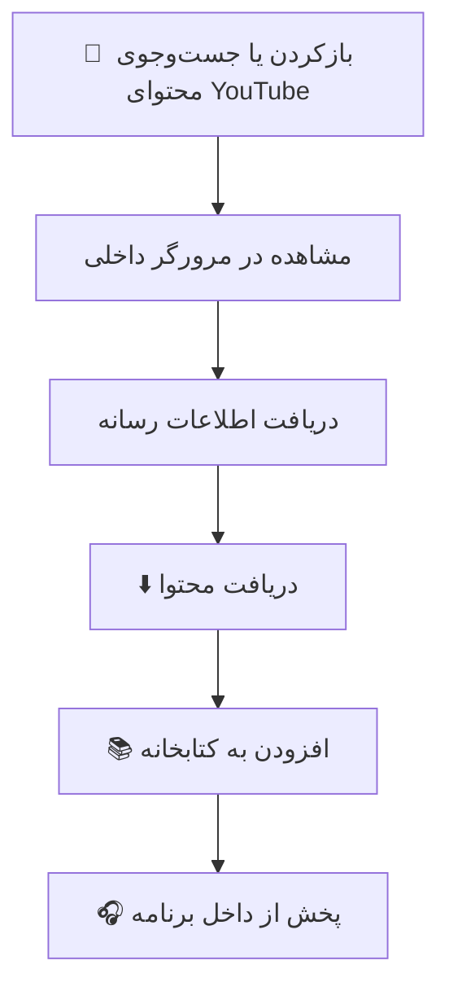

# 📺 KurdTube

<p align="center">
  <strong>جست‌وجو، پخش و مدیریت محتوای ویدیویی و صوتی در اندروید</strong>
  <br />
  تجربه‌ای یکپارچه برای بازکردن محتوای YouTube، پخش رسانه و نگه‌داری فایل‌های دریافت‌شده در کتابخانه‌ی برنامه.
</p>

<p align="center">
  
  
  
  <a href="https://github.com/HASSANTECHNO/KurdTube/releases"></a>
  <a href="https://github.com/HASSANTECHNO/KurdTube/actions/workflows/ci.yml"></a>
</p>

---

## 🎬 KurdTube چیست؟

KurdTube یک اپلیکیشن اندرویدی با رابط کاربری Jetpack Compose است که امکانات مرور محتوای YouTube، دریافت رسانه، پخش فایل‌های صوتی و مدیریت کتابخانه‌ی شخصی را در یک محیط واحد گرد هم می‌آورد.

## 📌 وضعیت نسخه

| مورد | مقدار |
|---|---|
| آخرین نسخه | `1.2` |
| حداقل اندروید | 7.0 (API 25) |
| targetSdk | 35 |
| زبان‌ها | English، کوردی سورانی، فارسی |
| تغییرات این نسخه | [`RELEASE_NOTES_1.2.md`](RELEASE_NOTES_1.2.md) |

## 🧭 مسیر استفاده



## ✨ امکانات

- **مرور محتوا:** بازکردن لینک‌های YouTube در مرورگر داخلی برنامه.
- **دریافت رسانه:** مدیریت فرایند دریافت محتوای انتخاب‌شده.
- **کتابخانه‌ی رسانه:** نگه‌داری و مدیریت فایل‌های دریافت‌شده.
- **پخش‌کننده:** پخش رسانه از داخل برنامه.
- **فهرست‌های پخش:** بارگذاری و مدیریت پلی‌لیست‌ها.
- **تنظیمات نمایشی:** پشتیبانی از تم روشن، تاریک و حالت هماهنگ با سیستم.
- **اشتراک‌گذاری لینک:** دریافت لینک YouTube از طریق قابلیت اشتراک‌گذاری اندروید و بازکردن آن در برنامه.
- **آمار ناشناس استفاده:** شمارش کاربران فعال و رویدادهای صفحه/دانلود با Firebase Analytics (بدون Advertising ID).

## 🧩 فناوری‌ها

| فناوری | کاربرد |
|---|---|
| Kotlin | منطق برنامه |
| Jetpack Compose | رابط کاربری |
| Android Lifecycle | مدیریت وضعیت و چرخه‌ی حیات |
| Media Player | پخش رسانه |
| YouTube URLs | بازکردن و پردازش لینک‌های محتوا |
| Firebase Analytics | آمار ناشناس استفاده |

## 🔥 راه‌اندازی Firebase Analytics

برای فعال کردن آمار ناشناس استفاده، فایل `app/google-services.json` را از Firebase Console بگیر و کنار `app/build.gradle` بگذار. راهنمای کامل: [`FIREBASE_SETUP.md`](FIREBASE_SETUP.md)

## 📦 دانلود و نصب

نسخه‌های رسمی از بخش [Releases](https://github.com/HASSANTECHNO/KurdTube/releases) قابل دانلود هستند.

1. فایل `KurdTube-1.2.apk` را از آخرین Release دانلود کن.
2. آن را نصب کن. اگر Play Protect پیام **«App scan recommended»** نشان داد، روی **«Install without scanning»** بزن. این پیام برای برنامه‌های خارج از Google Play عادی است و به معنی ویروس نیست.
3. برای اطمینان از سالم بودن فایل، مقدار SHA-256 داخل صفحه‌ی Release یا فایل `.sha256` پیوست‌شده را با مقدار فایل دانلودشده مقایسه کن.

> اگر قبلاً نسخه‌ی آزمایشی (debug) را نصب کرده‌ای، چون امضای نسخه‌ی رسمی متفاوت است، باید نسخه‌ی قبلی را حذف کنی و بعد APK جدید را نصب کنی.

## 🚀 انتشار نسخه‌ی جدید (GitHub Actions)

مخزن برای ساخت و انتشار خودکار APK امضاشده آماده است. فایل ورک‌فلو: [`.github/workflows/release.yml`](.github/workflows/release.yml)

### Secretهای لازم در GitHub

در `Settings → Secrets and variables → Actions` این مقادیر را اضافه کن:

| Secret | مقدار |
|---|---|
| `KEYSTORE_BASE64` | خروجی Base64 فایل keystore |
| `KEYSTORE_PASSWORD` | رمز keystore |
| `KEY_ALIAS` | `kurdtube` |
| `KEY_PASSWORD` | رمز کلید (در این پروژه همان رمز keystore است) |

ساخت مقدار Base64 در Termux:

```bash
base64 -w0 keystore/kurdtube-release.jks
```

### ساخت Release

```bash
git tag v1.2
git push origin v1.2
```

با push شدن تگ، GitHub Actions فایل APK را می‌سازد و به Release همان تگ پیوست می‌کند.

### ساخت دستی روی کامپیوتر

```bash
cp keystore.properties.example keystore.properties
# مقادیر واقعی را داخل keystore.properties بگذار
./gradlew assembleRelease
```

فایل خروجی: `app/build/outputs/apk/release/app-release.apk`

---

<p align="center">
  <strong>KurdTube — محتوا را باز کن، مدیریت کن و پخش کن.</strong>
</p>
