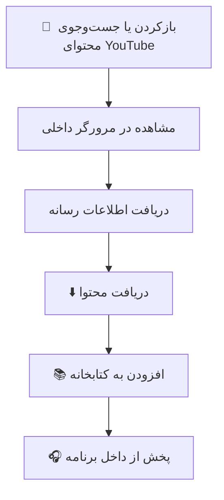

# 📺 KurdTube

  <strong>جست‌وجو، پخش و مدیریت محتوای ویدیویی و صوتی در اندروید</strong>
   
  تجربه‌ای یکپارچه برای بازکردن محتوای YouTube، پخش رسانه و نگه‌داری فایل‌های دریافت‌شده در کتابخانه‌ی برنامه.

  
  
  

---

## 🎬 KurdTube چیست؟

KurdTube یک اپلیکیشن اندرویدی با رابط کاربری Jetpack Compose است که امکانات مرور محتوای YouTube، دریافت رسانه، پخش فایل‌های صوتی و مدیریت کتابخانه‌ی شخصی را در یک محیط واحد گرد هم می‌آورد.

## 🧭 مسیر استفاده

## ✨ امکانات

- **مرور محتوا:** بازکردن لینک‌های YouTube در مرورگر داخلی برنامه.
- **دریافت رسانه:** مدیریت فرایند دریافت محتوای انتخاب‌شده.
- **کتابخانه‌ی رسانه:** نگه‌داری و مدیریت فایل‌های دریافت‌شده.
- **پخش‌کننده:** پخش رسانه از داخل برنامه.
- **فهرست‌های پخش:** بارگذاری و مدیریت پلی‌لیست‌ها.
- **تنظیمات نمایشی:** پشتیبانی از تم روشن، تاریک و حالت هماهنگ با سیستم.
- **اشتراک‌گذاری لینک:** دریافت لینک YouTube از طریق قابلیت اشتراک‌گذاری اندروید و بازکردن آن در برنامه.

## 🧩 فناوری‌ها

| فناوری | کاربرد |
|---|---|
| Kotlin | منطق برنامه |
| Jetpack Compose | رابط کاربری |
| Android Lifecycle | مدیریت وضعیت و چرخه‌ی حیات |
| Media Player | پخش رسانه |
| YouTube URLs | بازکردن و پردازش لینک‌های محتوا |

---

  <strong>KurdTube — محتوا را باز کن، مدیریت کن و پخش کن.</strong>

