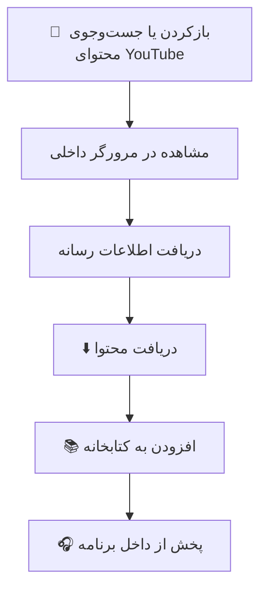

# 📺 KurdTube

<p align="center">
  <strong>جست‌وجو، پخش و مدیریت محتوای ویدیویی و صوتی در اندروید</strong>
  <br />
  تجربه‌ای یکپارچه برای بازکردن محتوای YouTube، پخش رسانه و نگه‌داری فایل‌های دریافت‌شده در کتابخانه‌ی برنامه.
</p>

<p align="center">
  
  
  
  <a href="https://github.com/HASSANTECHNO/KurdTube/releases"></a>
  <a href="https://github.com/HASSANTECHNO/KurdTube/actions/workflows/ci.yml"></a>
</p>

---

## 🎬 KurdTube چیست؟

KurdTube یک اپلیکیشن اندرویدی با رابط کاربری Jetpack Compose است که امکانات مرور محتوای YouTube، دریافت رسانه، پخش فایل‌های صوتی و مدیریت کتابخانه‌ی شخصی را در یک محیط واحد گرد هم می‌آورد.

## 📌 وضعیت نسخه

| مورد | مقدار |
|---|---|
| نسخه‌ی سورس | `1.3` (versionCode `130`) |
| آخرین APK منتشرشده | `1.1.8` |
| حداقل اندروید | 7.0 (API 25) |
| targetSdk | 35 |
| زبان‌ها | English، کوردی سورانی، فارسی |
| بیلد CI | تست واحد + APK دیباگ + APK ریلیز بدون امضا |

> نسخه‌ی `1.3` در سورس آماده است. برای انتشار رسمی، APK امضاشده را با Android Studio بساز. برای انتشار پولی در کافه‌بازار، راهنمای [`BAZAAR_PUBLISHING.md`](BAZAAR_PUBLISHING.md) را بخوان.

## 🧭 مسیر استفاده



## ✨ امکانات

- **مرور محتوا:** بازکردن لینک‌های YouTube در مرورگر داخلی برنامه.
- **دریافت رسانه:** مدیریت فرایند دریافت محتوای انتخاب‌شده.
- **دانلود پس‌زمینه‌ی سریع:** سرویس Foreground، Wake Lock، درخواست‌های Range بزرگ‌تر و استفاده‌ی مجدد از اتصال HTTP؛ دانلود هنگام خارج شدن از برنامه متوقف یا کند نمی‌شود.
- **اعلان پیشرفت و پایان دانلود:** نوار پیشرفت در اعلان با دکمه‌ی لغو، و اعلان «دانلود کامل شد» بعد از آماده شدن MP3.
- **کتابخانه‌ی رسانه:** نگه‌داری و مدیریت فایل‌های دریافت‌شده، بدون نمایش فایل‌های موقت یا ردیف‌های تکراری؛ دانلود دوباره‌ی همان ویدیو هم جلوگیری می‌شود.
- **پخش‌کننده:** پخش رسانه از داخل برنامه.
- **فهرست‌های پخش:** بارگذاری و مدیریت پلی‌لیست‌ها.
- **تنظیمات نمایشی:** پشتیبانی از تم روشن، تاریک و حالت هماهنگ با سیستم.
- **فونت کوردی سورانی:** فونت اختصاصی `RudawRegular` برای رابط کاربری کوردی سورانی.
- **به‌روزرسانی امن:** دانلود نسخه‌ی جدید، بررسی SHA-256 و سپس باز شدن نصب‌کننده. در نسخه‌ی نصب‌شده از بازار، به‌روزرسانی از طریق خود بازار انجام می‌شود.
- **اشتراک‌گذاری لینک:** دریافت لینک YouTube از طریق قابلیت اشتراک‌گذاری اندروید.
- **آمار ناشناس:** شمارش کاربران فعال و رویدادهای صفحه/دانلود با Firebase Analytics (بدون Advertising ID).
- **پروکسی عمومی اختیاری:** پیش‌فرض خاموش؛ فقط در صورت نیاز و با آگاهی از ریسک حریم خصوصی.

## 🧩 فناوری‌ها

| فناوری | کاربرد |
|---|---|
| Kotlin | منطق برنامه |
| Jetpack Compose | رابط کاربری |
| Android Lifecycle / ViewModel | مدیریت وضعیت و چرخه‌ی حیات |
| Media3 ExoPlayer | پخش رسانه |
| YouTube InnerTube | دریافت اطلاعات و لینک رسانه |
| Firebase Analytics | آمار ناشناس استفاده |
| GitHub Actions | تست، بیلد و انتشار |

## 📂 ساختار پروژه

```text
app/src/main/java/com/techno/kurdtube/
├── backend/        # دانلود، کتابخانه، پخش، آپدیت، تنظیمات، مجوزها
├── frontend/       # کامپوننت‌های Jetpack Compose
├── MainActivity.kt
└── MainViewModel.kt
app/src/test/       # تست‌های واحد (نسخه، YouTube API، checksum)
.github/workflows/  # CI و انتشار ریلیز
```

## 🚀 شروع سریع

### پیش‌نیازها

- Android Studio با پشتیبانی از AGP `8.6.1`
- JDK `17`
- Android SDK Platform `35` و Build-Tools `35.0.0`
- Gradle `8.7` (wrapper در پروژه موجود است)

### اجرا

1. پروژه را کلون کن:
   ```bash
   git clone https://github.com/HASSANTECHNO/KurdTube.git
   ```
2. در Android Studio: **File → Open** و پوشه‌ی پروژه را انتخاب کن.
3. اجازه بده Gradle Sync کامل شود.
4. روی دستگاه یا امولاتور اجرا کن.

### Firebase Analytics (اختیاری)

فایل `app/google-services.json` را از Firebase Console بگیر و در پوشه‌ی `app/` بگذار. این فایل در git نگه‌داری نمی‌شود. بدون آن هم برنامه build و اجرا می‌شود؛ فقط آمار غیرفعال می‌ماند. راهنمای کامل: [`FIREBASE_SETUP.md`](FIREBASE_SETUP.md)

## 🔐 ساخت نسخه‌ی Release (1.3)

### روش ۱ — Android Studio (پیشنهادی)

1. فایل `keystore.properties.example` را به `keystore.properties` کپی کن.
2. مقادیر keystore خودت را داخل آن بگذار:
   ```properties
   storeFile=keystore/kurdtube-release.jks
   storePassword=...
   keyAlias=kurdtube
   keyPassword=...
   ```
3. در Android Studio: **Build → Generate Signed Bundle / APK**.
4. گزینه‌ی **APK** و سپس **release** را انتخاب کن.
5. خروجی در این مسیر ساخته می‌شود:
   ```text
   app/build/outputs/apk/release/app-release.apk
   ```

> اگر `keystore.properties` وجود نداشته باشد، `assembleRelease` یک APK بدون امضا می‌سازد؛ برای انتشار عمومی باید آن را امضا کنی.

### روش ۲ — خط فرمان

```bash
cp keystore.properties.example keystore.properties
# مقادیر واقعی را داخل keystore.properties بگذار
./gradlew assembleRelease
```

### روش ۳ — GitHub Actions (انتشار خودکار)

Secretهای لازم در **Settings → Secrets and variables → Actions**:

| Secret | مقدار |
|---|---|
| `KEYSTORE_BASE64` | خروجی Base64 فایل keystore |
| `KEYSTORE_PASSWORD` | رمز keystore |
| `KEY_ALIAS` | `kurdtube` |
| `KEY_PASSWORD` | رمز کلید |
| `GOOGLE_SERVICES_JSON` (اختیاری) | محتوای کامل `google-services.json` برای فعال ماندن Firebase Analytics در CI |

ساخت مقدار Base64 در Termux/Linux:

```bash
base64 -w0 keystore/kurdtube-release.jks
```

برای انتشار، تگ نسخه را push کن:

```bash
git tag v1.3
git push origin v1.3
```

Workflow `Build signed release APK` فایل APK و checksum را می‌سازد و به Release همان تگ پیوست می‌کند.

> Workflow امضای APK را با fingerprint فعلی keystore بررسی می‌کند. اگر keystore را عوض کردی، خط مربوط به fingerprint در `.github/workflows/release.yml` را به‌روز کن.

### بیلد بدون امضا در CI

هر push به `master` یا هر Pull Request، workflow `Build and test` را اجرا می‌کند و این فایل‌ها را به‌عنوان artifact آپلود می‌کند:

- `app-debug.apk`
- `app-release-unsigned.apk`

## 🔒 امنیت و حریم خصوصی

- پروکسی عمومی مرورگر به‌صورت پیش‌فرض **خاموش** است.
- آپدیت‌ها فقط وقتی نصب می‌شوند که SHA-256 آن‌ها با فایل منتشرشده مطابقت داشته باشد.
- Firebase Analytics بدون Advertising ID و بدون ارسال محتوای کاربر.
- `keystore`، `keystore.properties` و `google-services.json` در git نگه‌داری نمی‌شوند.
- APKهای ساخته‌شده و فایل‌های IDE هم در مخزن نگه‌داری نمی‌شوند.

## 📦 دانلود

- نسخه‌های پایدار: [Releases](https://github.com/HASSANTECHNO/KurdTube/releases)
- آخرین نسخه‌ی منتشرشده در GitHub: `v1.1.8`
- نسخه‌ی `1.3`: از سورس یا Android Studio ساخته می‌شود و برای فروش در کافه‌بازار آماده است.

> اگر برنامه را در بازار **پولی** منتشر می‌کنی، APK رایگان همان نسخه را در GitHub Releases منتشر نکن؛ چون راه پرداخت بازار دور زده می‌شود. جزئیات در [`BAZAAR_PUBLISHING.md`](BAZAAR_PUBLISHING.md).

---

<p align="center">
  <strong>KurdTube — محتوا را باز کن، مدیریت کن و پخش کن.</strong>
</p>
